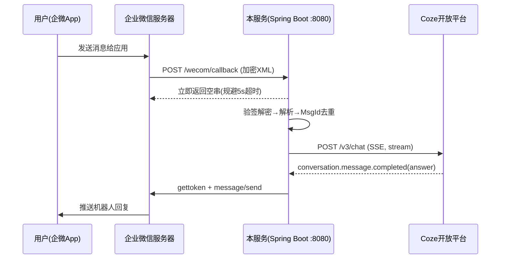
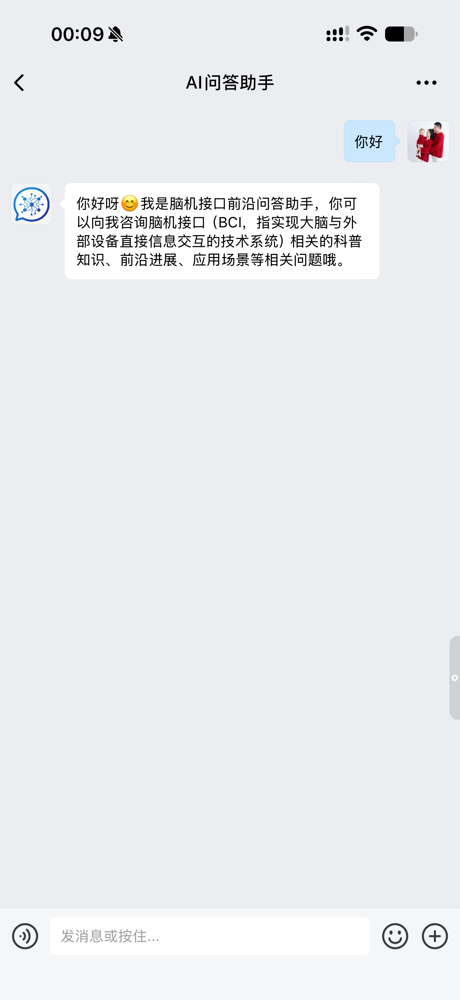
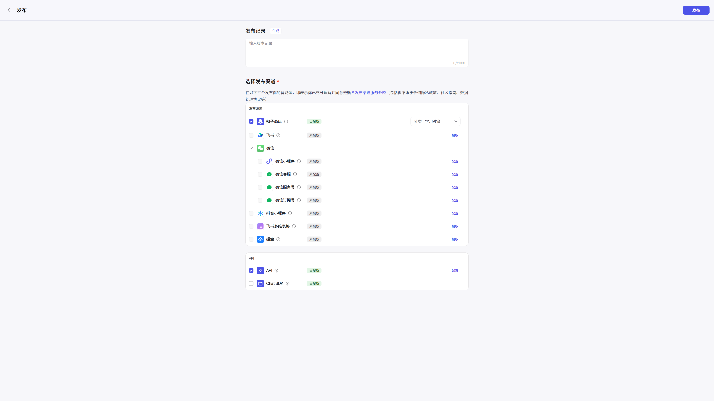
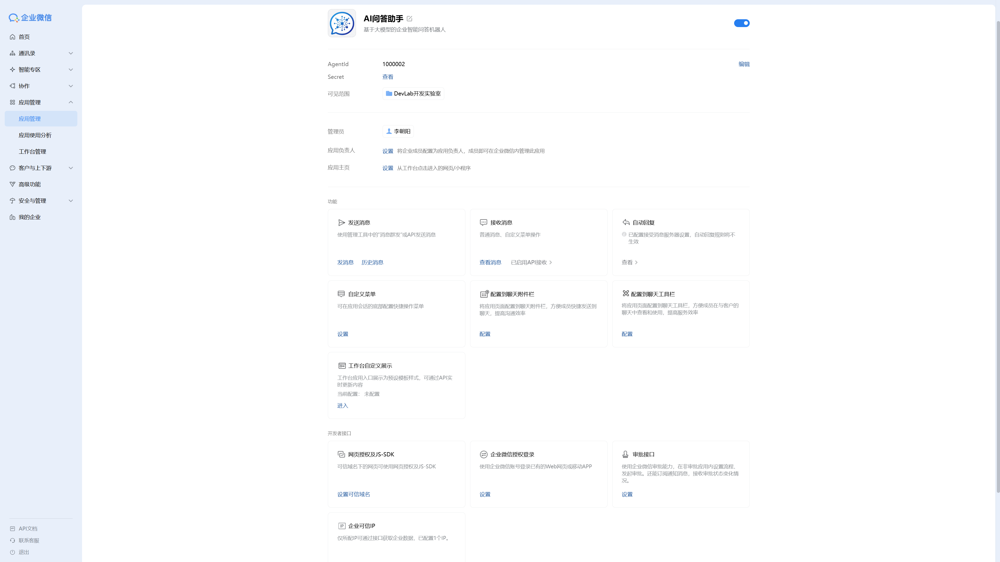

# 企业微信 AI 问答机器人

基于企业微信自建应用与 Coze 智能体的 AI 问答服务：员工在企微内向应用发送消息，服务端完成验签解密后调用 Coze 智能体生成回答，并通过企微服务端 API 主动推送回复。

## 功能特性

- **企微回调加解密**：完整实现微信官方加解密协议（AES-256-CBC + 自定义 PKCS7 填充 + SHA1 签名），支持回显验证与消息解密，含密文格式校验、签名篡改校验等安全防护
- **先应答后处理**：收到消息推送立即返回空串应答，规避企微 5 秒超时重推机制；业务逻辑异步执行
- **MsgId 去重**：`ConcurrentHashMap.putIfAbsent` + 惰性过期清理，兜底企微重推导致的重复消息
- **Coze v3 SSE 流式对话**：对接 Coze 开放平台 `/v3/chat`，逐行解析 SSE 事件流，聚合 `answer` 类型消息内容
- **企微主动回复**：`gettoken` 凭证缓存（提前 60s 刷新）+ `message/send` 文本消息推送
- **失败兜底**：AI 调用超时/异常时自动发送兜底文案，保证用户始终有反馈
- **配置全环境变量注入**：CorpID / Secret / AESKey / Token / Coze PAT 等敏感配置零硬编码

## 架构



## 项目结构

```
src/main/java/com/devlab/wecombot/
├── WecomBotApplication.java        # 启动类
├── config/
│   └── WecomProperties.java        # @ConfigurationProperties 配置绑定
├── controller/
│   └── WecomCallbackController.java # 回调入口：GET验证/POST消息/AI链路调度
├── crypto/                          # 企微官方加解密协议实现
│   ├── WXBizMsgCrypt.java          # 加解密/签名主类
│   ├── SHA1.java                   # 签名计算
│   ├── PKCS7Encoder.java           # PKCS7 填充
│   ├── XMLParse.java               # XML 提取(含XXE防护)
│   └── AesException.java
└── service/
    ├── ReplyMsgParser.java         # 消息XML解析(FromUserName/Content/MsgId)
    ├── MessageDeduper.java         # MsgId 去重(5分钟惰性过期)
    ├── CozeClient.java             # Coze v3/chat SSE 客户端
    └── WecomClient.java            # 企微 API 客户端(token缓存/发消息)
```

## 快速部署

1. 准备配置（`deploy/env.example.sh` 复制为 `env.sh`）：

```bash
export WECOM_CORP_ID="企业CorpID"
export WECOM_APP_SECRET="应用Secret"
export WECOM_AGENT_ID="应用AgentId"
export WECOM_TOKEN="回调Token"
export WECOM_AES_KEY="回调EncodingAESKey"
export WECOM_COZE_PAT="Coze个人访问令牌"
```

2. 构建并启动：

```bash
mvn package
bash start.sh   # 杀旧进程 + source env.sh + nohup 启动
```

3. 企微后台「接收消息」配置回调 URL（`http://<服务器IP>:8080/wecom/callback`）保存触发 echostr 验证。
4. 应用详情页配置「企业可信IP」为本服务器公网 IP（否则主动发消息报 60020）。
5. Windows 环境可直接运行 `deploy/一键部署.bat`（自动上传 jar、安装 Java、校验配置、公网连通性检查）。

## 生产注意事项

- 建议 systemd 托管进程替代 nohup，并持久化防火墙放行规则
- Coze 个人访问令牌最长 30 天有效期，到期需重新生成并更新
- 企微回调要求公网可直连（IP 直连方案，无需域名/HTTPS）

## 技术栈

Java 8 / Spring Boot 2.7 / Jackson / 企微服务端 API / Coze 开放平台 API

## 效果演示

### 企微对话实测



### Coze 智能体发布页



### 企微后台应用配置



员工在企微内向自建应用发送消息，机器人基于 Coze 智能体人设实时回复：

> 用户：你好
> 机器人：你好呀😊 我是脑机接口前沿问答助手，你可以向我咨询脑机接口（BCI）相关的科普知识、前沿进展、应用场景等相关问题哦。
